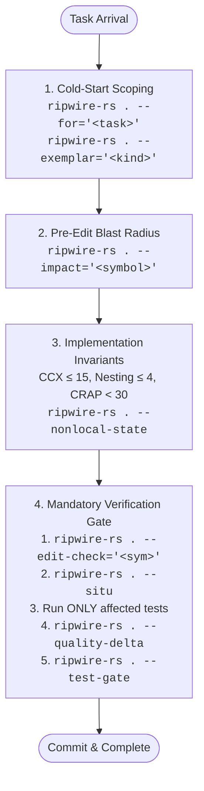
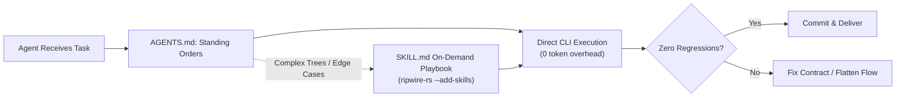

# Autonomous Agent Governance with AGENTS.md

`ripwire-rs` serves as the deterministic runtime engine and static verification backbone for AI coding agents (such as Omp, Claude Code, Cursor, Windsurf, Copilot, and custom autonomous swarms).

Rather than relying on vague, aspirational instructions ("write clean code", "be careful not to break tests"), `ripwire-rs` enables engineering teams to govern agents through **deterministic static analysis gates, call-graph data, and exit codes**.

---

## 1. Why Natural Language Rules Fail in AGENTS.md

Empirical studies across 2,500+ repositories reveal that standard agent configuration files fail primarily due to **instruction vagueness**:

1. **Token Exhaustion on Exploration**: Without deterministic scoping, agents crawl wide directory trees with `ls` or recursive `grep`, filling context windows with thousands of irrelevant tokens and losing sight of the original task.
2. **Blind Signature Mutation**: Agents regularly modify function arities, parameter types, or visibility without checking direct callers, causing silent regressions across the workspace.
3. **Monolithic or Skipped Testing**: Agents either run the entire monolithic test suite (causing timeouts) or skip testing entirely when they cannot easily determine which test covers the modified path.
4. **Subjective "Quality"**: Models cannot accurately evaluate their own code complexity, cognitive nesting, or AST duplication through visual self-inspection.

### The Static Verification Solution

By embedding `ripwire-rs` commands directly into `AGENTS.md`, you convert subjective advice into executable invariants:

| Traditional Prose Instruction | The ripwire-rs Enforced Reality |
| :--- | :--- |
| *"Inspect the codebase before editing"* | `ripwire-rs . --for="<task>"` retrieves ranked AST signatures under token budget. |
| *"Preserve public interfaces and caller compatibility"* | `ripwire-rs . --edit-check="<symbol>"` fails if any 1-hop caller contract breaks. |
| *"Run relevant tests before finishing"* | `ripwire-rs . --situ` maps exact transitive test reachability and historical co-change files. |
| *"Keep code simple and avoid high complexity"* | `ripwire-rs . --quality-delta` enforces zero regression against git `HEAD` (CCX $\le 15$, LOC $\le 60$). |
| *"Don't merge untested code"* | `ripwire-rs . --test-gate` exits code `4` if changes leave an untested blast radius. |

---

## 2. The 5-Step Autonomous Agent Lifecycle

An agent governed by `ripwire-rs` follows an invariant 5-step loop across every task:



---

## 3. Canonical Drop-In AGENTS.md Template

Place this file at your repository root (`./AGENTS.md`) or in your global agent configuration directory (`~/.agents/AGENTS.md`):

```markdown
# Engineering Standards & Static Verification

Enforce quality and architectural discipline using `ripwire-rs`. Rely on deterministic static analysis metrics, call-graph data, and exit codes over speculative text inspection.

## 1. Task Orientation & Scoping

- **Cold-Start Scoping**: Retrieve task-relevant signatures and declarations under token budget before reading files:
  `ripwire-rs . --for="<task description>"`
- **Pattern Reuse**: Locate existing canonical implementations to imitate before creating new abstractions:
  `ripwire-rs . --exemplar="<kind or task>"`
- **Pre-Edit Blast Radius**: Check transitive dependents before modifying or deleting signatures:
  `ripwire-rs . --impact="<symbol>"` (or `--safe-delete="<symbol>"`)

## 2. Code Quality & Structural Coupling

Code quality is enforced automatically by `ripwire-rs` default quality bars (Cognitive Complexity <= 15, Nesting <= 4, Params <= 5, LOC <= 60).

- **Change Risk (CRAP Ceiling)**: Any function modified or added with cyclomatic complexity `cx >= 5` (`ripwire-rs . --metrics`) MUST have test coverage. Keep flows linear or add tests.
- **God Files & Cycles**: Prevent cyclic dependencies and high-instability coupling:
  `ripwire-rs . --deps` (inspect `<godfiles>`, `<cycles>`, and `instab=`)
- **Local Reasoning**: Avoid functions requiring high external reasoning context:
  `ripwire-rs . --context-ratio`
- **Minimal Diffs**: Make the smallest coherent change that solves the root problem. Never mix formatting or refactoring into functional diffs.

## 3. Architectural Boundaries

- **Domain Core**: Business rules must be deterministic and I/O-free. Core functions must have zero non-local mutable state:
  `ripwire-rs . --nonlocal-state`
- **Dependency Isolation**: Core domain logic must remain free of framework, ORM, and SDK types:
  `ripwire-rs . --external-surface`
- **Thin Adapters & Layering**: Keep edge transport/storage adapters thin and coordination scripts swappable. If a repository defines layering rules (`rules.txt`), enforce them:
  `ripwire-rs . --arch=rules.txt` (exits 2 on violation)

## 4. Comment Policy

- Default to zero comments. Add a comment only for a durable, non-derivable external constraint (protocol quirk, hardware race, upstream bug citation). Max two lines; never restate code.
- Verify comment signal and prune echo comments:
  `ripwire-rs . --comment-coherence`

## 5. Mandatory Verification & Safety Gate

Never mark a task complete without executing this verification sequence on the working tree:

1. **Contract Check**: Verify modified signatures did not break direct callers:
   `ripwire-rs . --edit-check="<symbol>"`
2. **Situational Awareness & Targeted Tests**:
   `ripwire-rs . --situ`
   - Check reported `co-change` files for forgotten companion edits.
   - Run ONLY the test files listed under `tests to run`.
3. **Quality & Test Gates**: Ensure zero regressions and zero untested blast radius:
   `ripwire-rs . --quality-delta` (must report `regressions="0"`)
   `ripwire-rs . --test-gate` (must not exit 4)

## 6. Technical Debt & Refactoring

- **Maintenance Hotspots**: Refactor where churn intersects complexity: `ripwire-rs . --hotspots`
- **Dead Code & Clones**: Prune zero-caller functions (`ripwire-rs . --dead-code`) and AST clones (`ripwire-rs . --clones --min-tokens=40`).
- **Untested Seams**: Target cross-boundary call edges lacking tests: `ripwire-rs . --seams`

## 7. Multi-Agent & Parallel Work Delegation

- **Community Slicing**: Partition parallel agent tasks along call-graph clusters:
  `ripwire-rs . --pack-task="<task>" --partition=<N>`
- **Pre-Hoc Lane Planning**: Predict symbol collisions and optimal landing order:
  `ripwire-rs . --plan-lanes=<N> --task="<task>"`
- **Branch Conflicts**: Scout cross-branch merge collisions:
  `ripwire-rs . --merge-scout="branch-a,branch-b"`

## 8. Commit & Safety Discipline

- **Commit Format**: Conventional Commits (`type(scope): summary`). Append `Refs: <TICKET-ID>` if branch references an issue.
- **Safety**: Never expose secrets. Never run destructive commands (`rm -rf`, `git reset --hard`, `git push --force`, `DROP TABLE`) without explicit user confirmation.
- **Output**: Plain ASCII in generated repository artifacts. Concise, factual responses.
```

---

## 4. Skills vs. Direct CLI in AGENTS.md

A common design question is whether `AGENTS.md` should invoke skills (e.g., `skill://ripwire-rs-change-check`) or direct CLI commands.

### The Proven Architecture

- **`AGENTS.md` Contains Executable Commands**:  
  Empirical data shows that providing explicit commands with flags (`ripwire-rs . --edit-check="<sym>"`) produces deterministic, immediate execution without extra model round-trips. It also ensures full compatibility across tools that do not support dynamic skill loading (such as Cursor, Windsurf, and Copilot).
- **Skill Manifests Handle Deep Diagnostics**:  
  For skill-aware runners (like Omp or Claude Code), pre-packaged skills installed via:
  ```bash
  ripwire-rs --add-skills
  ```
  provide 17 on-demand playbooks for specialized moments (e.g. cross-branch merge trees, dark feature flag flipping, AST clone consolidation). The agent loads these detailed playbooks only when facing complex, multi-hop investigations.



---

## 5. Automated CI/CD Parity

The verification gates enforced in `AGENTS.md` are designed for 1:1 parity with your remote CI pipeline:

| Local Agent Gate (`AGENTS.md`) | Remote CI Gate (`ripwire-gate.yml`) | Automated Guarantee |
| :--- | :--- | :--- |
| `ripwire-rs . --edit-check="<sym>"` | Pre-commit / PR Check | Verifies zero broken 1-hop caller contracts. |
| `ripwire-rs . --situ` | `$GITHUB_STEP_SUMMARY` | Emits blast radius, tests to run, and co-change directly to PR review UI. |
| `ripwire-rs . --arch=rules.txt` | Architecture Gate | Enforces module layering boundaries (exits code 2 on violation). |
| `ripwire-rs . --test-gate` | Test Reachability Gate | Blocks merge if changes leave an untested blast radius (exits code 4). |
| `ripwire-rs . --quality-delta` | Quality Delta Gate | Blocks merge if complexity, nesting, or AST clones regressed vs base branch. |

For the complete, production-grade GitHub Actions workflow recipe and CI benchmark steps, see [Workflow 6: Continuous Integration (CI) Workflows & Automated PR Gates](WORKFLOWS.md#6-continuous-integration-ci-workflows--automated-pr-gates).
